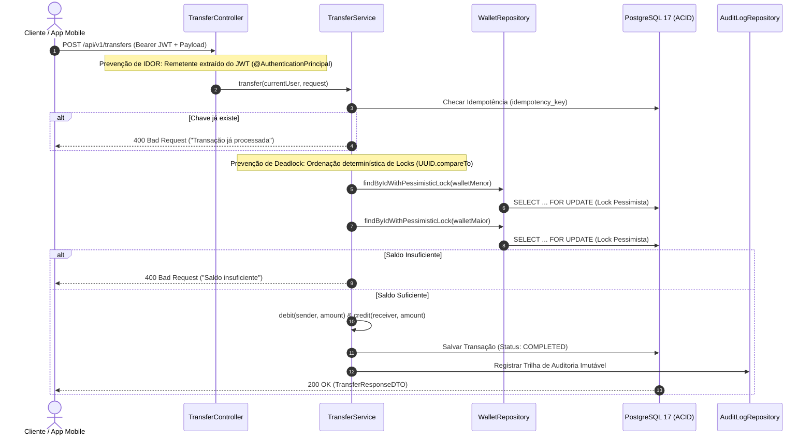

# 💳 FinSecure API — Digital Wallet & Resilient Payment Gateway


> **FinSecure API** é uma engine de pagamentos e carteira digital de alta concorrência desenvolvida sob os padrões mais rigorosos do mercado financeiro e de segurança de aplicações (**AppSec**). 
> O sistema implementa garantias estritas de transações **ACID**, prevenção contra **Double Spending (Race Conditions)**, imunidade matemática a **Deadlocks**, proteção contra ataques de repetição via **Idempotência**, segurança **Stateless com JWT**, e **Trilha de Auditoria Imutável**.

---

## 🎯 Arquitetura & Engenharia de Concorrência

Em ecossistemas de pagamentos (fintechs e adquirentes), falhas de concorrência resultam em prejuízo financeiro direto. Esta API foi desenhada com decisões arquiteturais deliberadas para mitigar os riscos mais críticos da indústria:



### 1. Prevenção de Double Spending (Pessimistic Write Lock)
* **Problema:** Múltiplas requisições simultâneas de débito para a mesma carteira podem ler o mesmo saldo antes da dedução (Race Condition).
* **Solução:** Uso de `@Lock(LockModeType.PESSIMISTIC_WRITE)` na consulta das carteiras (`SELECT ... FOR UPDATE`), enfileirando acessos no nível do banco de dados relacional.

### 2. Imunidade a Deadlocks (Ordenação Determinística de Recursos)
* **Problema:** Transferências cruzadas em paralelo (Alice transfere para Bob enquanto Bob transfere para Alice) geram dependência circular de locks, causando Deadlock (`40P01` no PostgreSQL).
* **Solução:** Algoritmo baseado no Teorema de Prevenção de Deadlocks de Dijkstra: os locks são adquiridos sempre em ordem determinística usando a comparação lexicográfica dos identificadores das carteiras (`senderId.compareTo(receiverId)`).

### 3. Proteção contra Repetições (Idempotência Estrita)
* **Problema:** Instabilidades de rede podem fazer com que um cliente reenvie a mesma solicitação de transferência, gerando cobranças duplicadas.
* **Solução:** Cada transação exige um cabeçalho/campo `idempotencyKey` (UUIDv4) com *Unique Constraint* no banco de dados e checagem *fail-fast* no Service.

---

## 🛡️ Segurança de Aplicações (AppSec) & Validações

* **Prevenção contra IDOR (Insecure Direct Object Reference):** O ID da carteira de origem **nunca** é enviado no corpo da requisição. O sistema recupera a identidade autenticada diretamente do token criptográfico (`@AuthenticationPrincipal User currentUser`), impedindo que um invasor debite da carteira de terceiros.
* **Validação Criptográfica e Pure CPU Modulo 11:** Anotação personalizada `@CpfOrCnpj` com validador estrito dos dígitos verificadores via Algoritmo Módulo 11, rejeitando entradas malformadas antes de tocar o banco de dados.
* **Autenticação Stateless (JWT):** Assinatura HMAC-SHA256 (`jjwt 0.12.6`) com tempo de expiração curto e filtros de segurança (`JwtAuthenticationFilter`) integrados à `SecurityFilterChain` do Spring Security 6.
* **Trilha de Auditoria Imutável:** Cada movimentação financeira gera um registro na tabela `tb_audit_logs`, gravando IDs envolvidos, valores, timestamps UTC e endereços IP para conformidade e perícia forense.

---

## 🗄️ Modelagem de Dados & Flyway Migrations

O versionamento do banco de dados é gerenciado pelo **Flyway**, garantindo que o esquema seja reproduzível e auditável:

* `tb_users`: Dados cadastrais com hashes BCrypt (`password_hash`), documentos únicos e status ativo.
* `tb_wallets`: Carteiras financeiras com precisão monetária (`DECIMAL(19, 4)`), moeda (`BRL`) e isolamento por chave estrangeira.
* `tb_transactions`: Registro das transferências com `idempotency_key` (chave única), status (`COMPLETED`, `FAILED`) e timestamps.
* `tb_audit_logs`: Tabela append-only com metadados para segurança e compliance.

---

## 🚀 Endpoints da API

A documentação interativa completa pode ser acessada via **Swagger UI** em:  
`http://localhost:8080/swagger-ui.html`

### Autenticação (`/api/v1/auth`)
| Método | Endpoint | Descrição | Autenticação |
| :--- | :--- | :--- | :--- |
| `POST` | `/api/v1/auth/register` | Cria novo usuário e inicializa carteira | Pública |
| `POST` | `/api/v1/auth/login` | Autentica e retorna Token Bearer JWT | Pública |

### Carteira (`/api/v1/wallets`)
| Método | Endpoint | Descrição | Autenticação |
| :--- | :--- | :--- | :--- |
| `GET` | `/api/v1/wallets/me` | Retorna ID e saldo da carteira do usuário | Bearer JWT |

### Transferências (`/api/v1/transfers`)
| Método | Endpoint | Descrição | Autenticação |
| :--- | :--- | :--- | :--- |
| `POST` | `/api/v1/transfers` | Executa transferência atômica com lock pessimista | Bearer JWT |

#### Exemplo de Payload de Transferência (`POST /api/v1/transfers`):
```json
{
  "receiverWalletId": "a316df7d-906f-4005-a3d1-0720c9e4b2c9",
  "amount": 50.00,
  "idempotencyKey": "9b1deb4d-3b7d-4bad-9bdd-2b0d7b3dcb6d"
}
```

---

## 🧪 Estratégia de Testes Automatizados

O projeto adota a pirâmide de testes para garantir robustez e performance:

```bash
# Executar suíte de testes unitários
./mvnw test -Dtest="*ServiceTest"
```

* **Testes de Isolamento com Mockito:** Cobertura de regras críticas de negócio (débito, crédito, validação de saldo insuficiente, idempotência duplicada e cadastro de duplicados).
* **Verificação de Efeitos Colaterais:** Testes com asserções estritas que garantem que, em caso de saldo insuficiente, nenhuma entidade é salva (`verify(..., never()).save(...)`).
* **Testes de Contexto Spring Boot:** Validação do ciclo de vida das entidades e injeção de dependências (`@SpringBootTest`).

---

## ⚙️ Como Executar o Projeto Localmente

### Pré-requisitos
* **Java 21** (OpenJDK)
* **Docker** e **Docker Compose**
* **Maven** (ou use o wrapper incluso `./mvnw`)

### 1. Iniciar o Banco de Dados PostgreSQL 17 via Docker
```bash
docker run --name finsecure-postgres \
  -e POSTGRES_DB=finsecure_db \
  -e POSTGRES_USER=finsecure_user \
  -e POSTGRES_PASSWORD=finsecure_password \
  -p 5432:5432 -d postgres:17-alpine
```

### 2. Compilar e Iniciar a Aplicação
```bash
# No Linux/macOS:
./mvnw clean spring-boot:run

# No Windows (PowerShell):
.\mvnw.cmd clean spring-boot:run
```

A aplicação estará disponível em `http://localhost:8080`.

---

## 👨‍💻 Autor

Desenvolvido por **Murillo Kennedy**  
Estudante de Ciência da Computação | Foco em Java Backend & Application Security (AppSec)  
* [LinkedIn](https://www.linkedin.com/in/murillokennedy/)
* [GitHub](https://github.com/murillokennedy)
