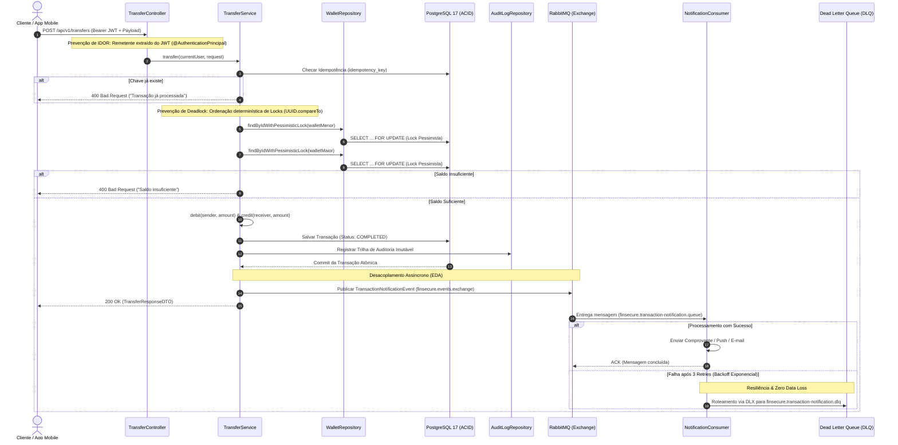

# 💳 FinSecure API — Digital Wallet & Resilient Payment Gateway

[](https://github.com/MurilloK14/finsecure-api/actions/workflows/ci.yml)


> **FinSecure API** é uma engine de pagamentos e carteira digital de alta concorrência desenvolvida sob os padrões mais rigorosos do mercado financeiro e de segurança de aplicações (**AppSec**). 
> O sistema implementa garantias estritas de transações **ACID**, prevenção contra **Double Spending (Race Conditions)**, imunidade matemática a **Deadlocks**, proteção contra ataques de repetição via **Idempotência**, segurança **Stateless com JWT**, **Trilha de Auditoria Imutável**, **Arquitetura Orientada a Eventos (EDA)** com **RabbitMQ + DLQ**, **Cache & Rate Limiting Distribuído com Redis** e observabilidade em tempo real com **Prometheus & Grafana**.

---

## 🎯 Arquitetura & Engenharia de Concorrência

Em ecossistemas de pagamentos (fintechs e adquirentes), falhas de concorrência e acoplamento síncrono resultam em prejuízo financeiro e indisponibilidade. Esta API foi desenhada com decisões arquiteturais deliberadas para mitigar os riscos mais críticos da indústria:



### 1. Prevenção de Double Spending (Pessimistic Write Lock)
* **Problema:** Múltiplas requisições simultâneas de débito para a mesma carteira podem ler o mesmo saldo antes da dedução (Race Condition).
* **Solução:** Uso de `@Lock(LockModeType.PESSIMISTIC_WRITE)` na consulta das carteiras (`SELECT ... FOR UPDATE`), enfileirando acessos no nível do banco de dados relacional.

### 2. Imunidade a Deadlocks (Ordenação Determinística de Recursos)
* **Problema:** Transferências cruzadas em paralelo (Alice transfere para Bob enquanto Bob transfere para Alice) geram dependência circular de locks, causando Deadlock (`40P01` no PostgreSQL).
* **Solução:** Algoritmo baseado no Teorema de Prevenção de Deadlocks de Dijkstra: os locks são adquiridos sempre em ordem determinística usando a comparação lexicográfica dos identificadores das carteiras (`senderId.compareTo(receiverId)`).

### 3. Proteção contra Repetições (Idempotência Estrita)
* **Problema:** Instabilidades de rede podem fazer com que um cliente reenvie a mesma solicitação de transferência, gerando cobranças duplicadas.
* **Solução:** Cada transação exige um cabeçalho/campo `idempotencyKey` (UUIDv4) com *Unique Constraint* no banco de dados e checagem *fail-fast* no Service.

---

## 📨 Mensageria Assíncrona & Resiliência AMQP (RabbitMQ)

Para garantir alta disponibilidade e tempos de resposta na ordem de milissegundos, o processamento de comprovantes e notificações foi completamente desacoplado da transação financeira através do **RabbitMQ**:

* **Desacoplamento Temporal e de Falhas:** A transferência é confirmada para o cliente imediatamente após o commit no banco de dados. Caso serviços de terceiros (provedores de e-mail, SMS ou gateways de push) fiquem indisponíveis, a transação financeira **não sofre rollback**.
* **Serialização JSON Segura:** DTOs/Records imutáveis (`TransactionNotificationEvent`) serializados via `Jackson2JsonMessageConverter` em formato UTF-8 padronizado.
* **Política de Retentativas com Backoff Exponencial:** O consumidor tenta processar a mensagem até 3 vezes (com intervalos de 1s, 2s e 4s), absorvendo oscilações transitórias de rede.
* **Dead Letter Exchange (DLX) & Dead Letter Queue (DLQ):** Caso a falha persista após as tentativas, o `RepublishMessageRecoverer` intercepta a mensagem e a roteia para a fila `finsecure.transaction-notification.dlq`, anexando cabeçalhos de diagnóstico (`x-exception-message`, `x-exception-stacktrace`, `x-original-exchange`), garantindo **Zero Perda de Dados** e rastreabilidade para auditoria técnica.

---

## 🛡️ Segurança de Aplicações (AppSec) & Validações

* **Rate Limiting Distribuído & Defesa contra Brute-Force / DoS (Token Bucket + Redis):** Implementação atômica com **Bucket4j + Lettuce (`ProxyManager` no Redis)** integrada à `SecurityFilterChain` (`RateLimitFilter`). Como o estado dos tokens fica centralizado no Redis via *Compare-And-Swap (CAS)* com auto-expiração (TTL), múltiplas réplicas da API compartilham os mesmos limites (impedindo bypass em escalabilidade horizontal e evitando *memory leak* na JVM). Protege endpoints críticos de autenticação (5 req/min por IP em `/auth/login`) e transferências (10 req/min por usuário autenticado), retornando `HTTP 429 Too Many Requests` com cabeçalho `Retry-After` e payload explicativo.
* **Prevenção contra IDOR (Insecure Direct Object Reference):** O ID da carteira de origem **nunca** é enviado no corpo da requisição. O sistema recupera a identidade autenticada diretamente do token criptográfico (`@AuthenticationPrincipal User currentUser`), impedindo que um invasor debite da carteira de terceiros.
* **Validação Criptográfica e Pure CPU Modulo 11:** Anotação personalizada `@CpfOrCnpj` com validador estrito dos dígitos verificadores via Algoritmo Módulo 11, rejeitando entradas malformadas antes de tocar o banco de dados.
* **Autenticação Stateless (JWT):** Assinatura HMAC-SHA256 (`jjwt 0.12.6`) com tempo de expiração curto e filtros de segurança (`JwtAuthenticationFilter`) integrados à `SecurityFilterChain` do Spring Security 6.
* **Trilha de Auditoria Imutável:** Cada movimentação financeira gera um registro na tabela `tb_audit_logs`, gravando IDs envolvidos, valores, timestamps UTC e endereços IP para conformidade e perícia forense.

---

## ⚡ Cache Distribuído & Escalabilidade Stateless (Redis)

Para suportar alto volume de consultas de saldo sem sobrecarregar o PostgreSQL e manter a API preparada para escala horizontal (*stateless*), o **Redis 7** atua tanto como cache distribuído quanto como repositório central de estado:

* **Padrão Cache-Aside (`@Cacheable`):** As leituras de carteira (`GET /api/v1/wallets/me`) consultam primeiro o Redis em complexidade $O(1)$ com TTL de 10 minutos, reduzindo latência e preservando conexões do pool JDBC (HikariCP).
* **Consistência Financeira Estrita (`@CacheEvict`):** Em toda transferência concluída (`TransferService`), o cache das duas carteiras envolvidas (remetente e destinatário) é imediatamente invalidado via Proxy AOP do Spring, evitando leituras de saldo desatualizado (*stale data*) e race conditions de escrita.
* **Serialização JSON Segura (AppSec):** Os DTOs em cache utilizam `RedisSerializer.json()` (Jackson) em vez de serialização binária nativa do Java, mitigando riscos de desserialização insegura (`CWE-502`) e facilitando inspeção em tempo real via `redis-cli`.

---

## 🗄️ Modelagem de Dados & Flyway Migrations

O versionamento do banco de dados é gerenciado pelo **Flyway**, garantindo que o esquema seja reproduzível e auditável:

* `tb_users`: Dados cadastrais com hashes BCrypt (`password_hash`), documentos únicos e status ativo.
* `tb_wallets`: Carteiras financeiras com precisão monetária (`DECIMAL(19, 4)`), moeda (`BRL`) e isolamento por chave estrangeira.
* `tb_transactions`: Registro das transferências com `idempotency_key` (chave única), status (`COMPLETED`, `FAILED`) e timestamps.
* `tb_audit_logs`: Tabela append-only com metadados para segurança e compliance.

---

## 🚀 Endpoints da API

A documentação interativa completa pode ser acessada via **Swagger UI** em:  
`http://localhost:8080/swagger-ui.html`

### Autenticação (`/api/v1/auth`)
| Método | Endpoint | Descrição | Autenticação |
| :--- | :--- | :--- | :--- |
| `POST` | `/api/v1/auth/register` | Cria novo usuário e inicializa carteira | Pública |
| `POST` | `/api/v1/auth/login` | Autentica e retorna Token Bearer JWT | Pública |

### Carteira (`/api/v1/wallets`)
| Método | Endpoint | Descrição | Autenticação |
| :--- | :--- | :--- | :--- |
| `GET` | `/api/v1/wallets/me` | Retorna ID e saldo da carteira do usuário | Bearer JWT |

### Transferências (`/api/v1/transfers`)
| Método | Endpoint | Descrição | Autenticação |
| :--- | :--- | :--- | :--- |
| `POST` | `/api/v1/transfers` | Executa transferência atômica com lock pessimista | Bearer JWT |

#### Exemplo de Payload de Transferência (`POST /api/v1/transfers`):
```json
{
  "receiverWalletId": "a316df7d-906f-4005-a3d1-0720c9e4b2c9",
  "amount": 50.00,
  "idempotencyKey": "9b1deb4d-3b7d-4bad-9bdd-2b0d7b3dcb6d"
}
```

---

## 🧪 Estratégia de Testes Automatizados

O projeto adota uma estratégia completa de testes unitários, integração e estresse de concorrência:

```bash
# Executar suíte de testes unitários
./mvnw test -Dtest="*ServiceTest,RateLimitFilterTest"

# Executar testes de carga e estresse com K6
k6 run load-tests/rate-limit-stress.js
k6 run load-tests/transfer-concurrency-stress.js
```

* **Testes de Isolamento com Mockito:** Cobertura de regras críticas de negócio (débito, crédito, validação de saldo insuficiente, idempotência duplicada e cadastro de duplicados).
* **Testes de Rate Limiting:** Validação determinística de consumo de tokens por IP e bloqueio com HTTP 429 na 6ª tentativa.
* **Testes de Carga Concorrente com K6:** Simulação de múltiplos usuários virtuais (VUs) executando transferências simultâneas com validação de zero double-spending e imunidade a deadlocks.

---

## 📊 Observabilidade em Tempo Real (Prometheus & Grafana)

A saúde, performance e concorrência da aplicação são monitoradas ponta a ponta sem degradação de performance:

* **Métricas via Spring Boot Actuator & Micrometer:** Exposição das métricas da JVM (Heap Memory, Garbage Collection, Threads), pool de conexões JDBC (**HikariCP**) e latência das rotas HTTP no endpoint `/actuator/prometheus`.
* **Prometheus Time-Series DB:** Agente de coleta configurado com polling periódico a cada 5 segundos para reter séries temporais de tráfego.
* **Grafana Dashboards:** Visualização gráfica interativa em tempo real com painéis para monitorar Throughput (req/s), latência $p95$ e consumo de conexões durante os testes de estresse (Dashboard ID recomendado: `19004`).

---

## ⚙️ Como Executar o Projeto Localmente

### Pré-requisitos
* **Docker** e **Docker Compose**  
*(Java 21 e Maven são opcionais caso execute diretamente via Docker!)*

### 1. Execução Total via Docker Compose (Modo Conteinerizado)
Suba o ecossistema completo (FinSecure API + PostgreSQL 17 + Redis 7 + RabbitMQ 3 + Prometheus + Grafana) com um único comando:
```bash
docker compose up --build -d
```
* **API & Swagger UI:** `http://localhost:8080/swagger-ui.html`
* **PostgreSQL:** `localhost:5432` (database: `finsecure_db`)
* **Redis:** `localhost:6379`
* **RabbitMQ AMQP:** `localhost:5672`
* **RabbitMQ Management UI:** `http://localhost:15672` (Usuário: `finsecure_user` | Senha: `finsecure_password`)
* **Prometheus:** `http://localhost:9090`
* **Grafana:** `http://localhost:3000` (Usuário: `admin` | Senha: `admin`)

### 2. Modo Híbrido / Desenvolvimento Local (IntelliJ IDEA)
Caso deseje depurar e alterar o código localmente no IntelliJ:
```bash
# 1. Inicie apenas a infraestrutura externa
docker compose up postgres rabbitmq redis -d

# 2. Execute a aplicação via wrapper ou IntelliJ:
# No Linux/macOS:
./mvnw clean spring-boot:run

# No Windows (PowerShell):
.\mvnw.cmd clean spring-boot:run
```

A aplicação estará disponível em `http://localhost:8080`.

---

## 👨‍💻 Autor

Desenvolvido por **Murillo Kennedy**  
Estudante de Ciência da Computação | Foco em Java Backend & Application Security (AppSec)  
* [LinkedIn](https://www.linkedin.com/in/murillokennedy/)
* [GitHub](https://github.com/murillokennedy)
